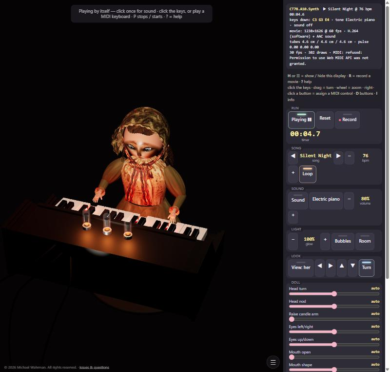

# CT78.A10.Synth — context file

**Series:** CT78 Synth · **Version:** A10 · **Date:** 2026-11-20 · **Built from:** `CT78.A9.Synth` (copied and renamed; A1–A9 unchanged; read `CT78.A9.Synth/CT78.A9.Synth.md` for items 39–45, and `CT78.A8.Synth/CT78.A8.Synth.md` for the doll's pose solver and the instruments) · **Project label: F (fantasy / art)** · Sonnet 5.5, then Opus 5.5 (the switch took effect partway through the follow-up).
The session was moved to this folder before any edit. Open issues: [ISSUES.html](ISSUES.html).

© 2026 Michael Wahrman. All rights reserved.

## Requests (A10, 2026-11-20)
> 46. Remove the spinning shit from under the tubes.  I didnt ask for that, did I?
> 47. I just wanted the same controls from the original dolls, activated, so you could see her animate.  Put it all in one column and get rid of the other shit you added
> 48. Will you stop it with adding shit already if I havent asked for it?
> 49. I had the model set to opus, why the fuck is it on sonnet again?
> 50. The starting position should be further back, e.g. she should be smaller in frame
> 51. This is what the vacuum tubes should look like: `C:\Users\micha\Downloads\claude\images\toys\vaccuum tubes 1.webp`

## What A10 changed
46. **The spinning thing is gone:** the corkscrew coil I put inside each tube in A9 (it looked like a turning screw as the camera drifts round).
47. **The original dolls' controls, in the one right-hand column.** The puppet column and everything in it are gone (the column, the hand sliders, "Hold key", "Puppeteer her", the U key, the Puppet button, the puppet code). A **Doll** group in the right-hand column has the controls of CT68's dolls: the sliders of its CONTROLS list (head turn, head nod, arm raise, eyes left/right and up/down, mouth open and shape, body sway, spin, eyelids), and the buttons Sing, Talk, Spin 360°, Blink, Auto blink, and All auto. A slider shows "auto" until you move it; moving it takes that control over from the doll; double-click it to give it back. Sing and Talk are CT68's own (the mouth forms words, with a sway and a small turn of the head). The arm raise only shows while her hands are not playing (they are posed by the A8 solver while she plays).
48. **Nothing else was added.** What I did add to do these, and nothing more: `_dollctl.js` (the Doll group) and a few lines in `_doll.js` that let the sliders override her pose.
49. **The model:** this session was started on Sonnet 5.5; I do not know why it was not on Opus, and I cannot switch it myself (the app refuses a session changing its own model). After you picked Opus in the menu it took effect partway through the follow-up below (a change applies from the next turn).
50. **Start view further back:** distance 210 (A9: 120), a little lower, so she is smaller in the frame (about 60% of the picture's height, was most of it).
51. **The tubes, from your photo** (4 clear-glass tubes on a chassis, orange glow): each tube is now **clear glass with a domed top**, a **metal base ring**, a **dark plate** with a **mica cap** and two **brass grid rods** inside, a **glowing orange strip** on the plate and a **glowing filament at the foot**, with a soft orange glow; no red tint, no liquid, no bubbles, no coil. Still small (4.6 cm tall, 1 cm radius, as A9).

## Follow-up in A10 (same day, no new version number was given)
> 52. The tubes should fucking glow, ok?
> 53. Why dont the controls animate the way they did on the dolls as she moves the controls used to animate
> 54. Its ok if she smiles now and then.

52. **The tube glow (undone):** I turned the glow up (glow 0.95, a halo round each tube, bigger glow sprites, brighter filament); you said the tubes looked horrible, so all of that is taken out again and the tubes are as before request 52.
53. **The sliders move with her**, as in CT68: a slider you have not taken over shows what she is doing now (head turn, nod, eyes, mouth, etc.), every frame. Moving one still takes it over; double-click gives it back. Checked: the mouth-shape slider read 0.90 during a smile.
54. **A smile now and then:** every 5–13 s, for 1.6–2.8 s, her mouth goes wide and nearly closed (shape 0.9, open 0.1); a sung word still opens it. **Limit:** CT68's dolls have no smile control, only mouth open and mouth shape. In a close-up this reads as a wide, closed mouth, not a clear smile (the corners do not turn up). A real smile would mean changing the mouth's shape in the CT68 doll code (the copy in `CT78.A10.Synth_lib`): see issues.

> 55. There should be a notice to click on the screen to activate audio

55. **Sound notice:** "Click on the screen to turn the sound on" sits at the bottom of the picture until a click or a key starts the sound (or the Sound button turns it on); it does not show with `?sound=0`. Checked: shown at load, gone after one click, sound running.

> 56. Joy to the world goes on too long, cut a verse
> 57. Its ok if she moves her mouth now and then, but not all the time
> 58. She should start a little further back (e.g. smaller) but not by much

56. **Joy to the World: three verses** (about 67 s, was 89). I cut the third, "No more let sins and sorrows grow" (the one most hymnals leave out); the first, second and fourth stay.
57. **She mouths the words now and then:** only in about 4 of every 10 eight-beat stretches (the same ones each time the song plays); in the others her mouth stays closed. Counted: Silent Night 12 of 41 syllables, Joy 35 of 126, We Wish You 11 of 60. (The occasional smile is unchanged.)
58. **Start view a little further back:** distance 235 (was 210).
59. **Joy to the World: two verses** ("Two verses on joy to the world is sufficient"): the first and second; about 44 s.

60. **Sound while recording** ("Audio is fucked when record is on"): measured: the recorder made 156 frames in 6 s (about 26 a second, not 60; the picture is 1238x1626, H.264 in software), so the speakers, fed one movie frame at a time, ran dry in 280 of 281 audio blocks. Your choice: **the speakers are muted while recording**; the movie keeps its sound (made frame by frame with the picture). Not checked: listening to a recorded movie.
61. **Movies at half the display size** (your OK): e.g. 619x813 for a 1238x1626 picture. The speakers stay muted while recording. My frame-rate measurements in the preview pane are not reliable (the pane was hidden, which slows the page), so whether half size now keeps up at 60 fps on your screen is not known.

62. **The curls at the back of her head** (aliasing): the curls' opacity is lowered to 0.35 (CT68's default 0.6), as you suggested. Their hair style, colour and the solid cap on top are unchanged. In the browser the curls are drawn dithered (a fine speckle) when they are see-through; I looked at one close-up only.

63. **No curls on the back of her head:** 14 of her 16 curls (all behind the middle of her head) are hidden; the 2 beside her face and the cap of hair stay. Looked at from behind: no curls show.

64. **No curls at all** ("Remove all curls, they alias"; you numbered it 62): all 16 curls are hidden; the cap of hair under her bonnet stays.

## Checked (2026-11-20, built-in browser, localhost)
- `node --check` on every script; no console errors.
- One column only (the picture and the right-hand column); the Doll group has 10 sliders and 6 buttons.
- A slider overrides the pose (head nod set to 20 showed 20); Sing turned the mouth on (open 0.81 after 3 s).
- The start view and a close-up of a tube were looked at (screenshots); the picture of the start view is in `images/`.
- Not re-run: the songs, the hold between songs and the 5 s pause (unchanged from A9, where they were measured).
- **Not checked:** the tubes against your photo from other angles (I compared one close-up by eye; the photo is a photograph and mine is a simple model), Talk, Spin 360° and Auto blink by eye, the arm raise slider, the sound, the page at real speed, MIDI (the dolls' own MIDI map is not connected), a phone, a movie.

## Liberties taken (please check)
- "The same controls from the original dolls": I took them to be CT68's sliders and buttons (CONTROLS, Sing, Talk, Spin, Blink, Auto blink). I did not include CT68's candle, noise, hair, or MIDI-map panels, nor its keyboard shortcuts (S, T, B, P conflict with this toy's keys).
- "Put it all in one column": the existing right-hand column.
- The tube's inner parts and glow are my approximation of the photo.
- "Further back": 210 (A9: 120); say if you want it nearer or further.

## Files
As A9's, renamed `CT78.A10.Synth_*.js`. Changed: `_model.js` (the tubes), `_doll.js` (the puppet hooks taken out; `D.manual` overrides), `_main.js` (start view), `index.html` (one column, Doll group). New: `_dollctl.js`. Removed from A10 (still in A9): `_puppet.js`, the `.claude/launch.json`.

